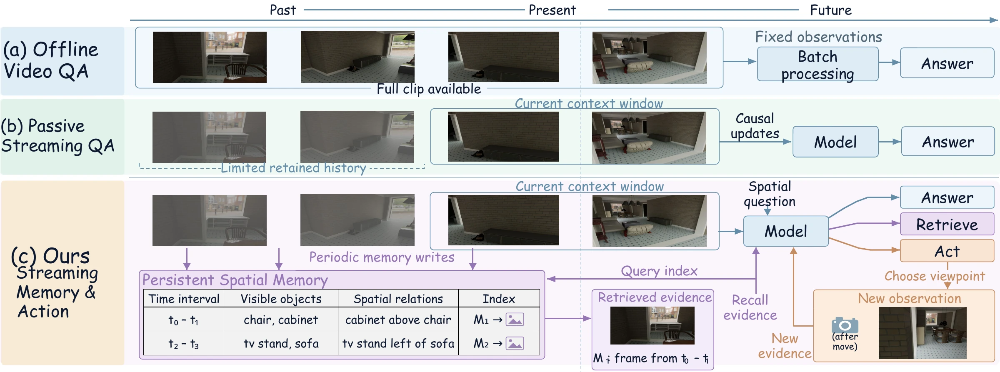
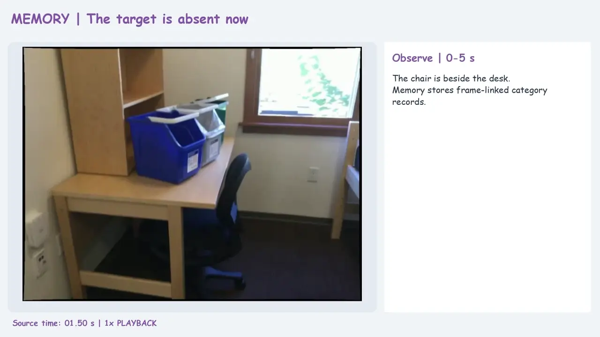
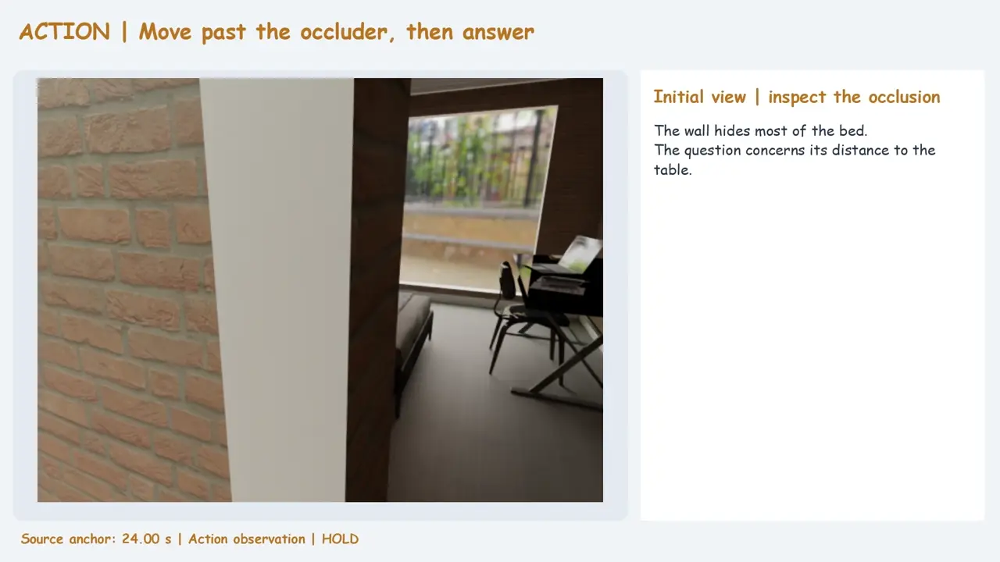
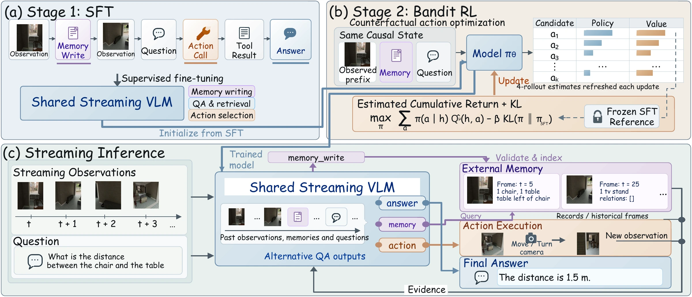
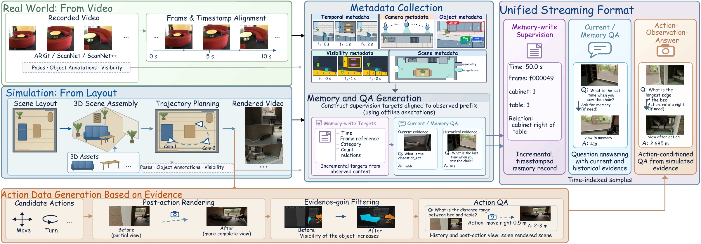

<h1 align="center">MemAct</h1>
<h3 align="center">Streaming Spatial Understanding with Memory and Active Exploration</h3>

<p align="center">
  Yuxi Wei<sup>1</sup> · Wei Huang<sup>1</sup> · Qirui Chen<sup>3</sup> · Lu Hou<sup>2,*</sup> · Xiaojuan Qi<sup>1,*</sup>
</p>
<p align="center">
  <sup>1</sup> The University of Hong Kong<br>
  <sup>2</sup> Yinwang Intelligent Technology Co. Ltd<br>
  <sup>3</sup> Shanghai Jiao Tong University<br>
  <sub>* Corresponding authors</sub>
</p>
<p align="center">
  <a href="https://vfishc.github.io/memact/"></a>
  <a href="https://vfishc.github.io/memact/assets/memact-paper.pdf"></a>
  <a href="https://huggingface.co/datasets/vfishc/memact"></a>
  <a href="https://vfishc.github.io/memact/#demos"></a>
</p>

<p align="center"><b>Remember past observations. Retrieve the evidence. Act to resolve information gaps.</b></p>

<p align="center">
  <a href="docs/assets/teaser.webp"></a>
</p>

A continuous video stream does not always contain the evidence needed to answer a spatial question. **MemAct** combines incremental memory writing, historical evidence retrieval, and active camera exploration in a shared vision–language model. The model can answer from the current context, recover earlier observations, or acquire another view before answering.

<p align="center">
  <a href="#highlights">Highlights</a> · <a href="#demos">Demos</a> · <a href="#method">Method</a> · <a href="#results">Results</a> · <a href="#quick-start">Quick start</a> · <a href="#data--downloads">Data</a> · <a href="CODE_GUIDE.md">Code guide</a>
</p>

## Highlights

- **A unified streaming task:** Current, Memory, and Action QA test reasoning from present observations, historical evidence, and actively acquired views.
- **Memory that remains accessible:** the model writes structured observations and spatial relations; a deterministic router retrieves records and historical images on request.
- **Actions trained for downstream value:** supervised trajectories establish the interaction protocol, and cumulative-return optimization rewards subsequent evidence and answer quality, including useful preparatory moves.
- **A large supervision resource:** 1,000,000 QA answer turns, with additional memory-write and retrieval supervision, simulated scenes, and three real-world video sources.

## Demos

Click a preview to open its video. These are dataset and evidence examples; the project website also includes an interactive memory walkthrough and a searchable example gallery.

<table>
  <tr>
    <th width="50%">Recover historical evidence</th>
    <th width="50%">Acquire a better view</th>
  </tr>
  <tr>
    <td><a href="https://vfishc.github.io/memact/assets/memory.mp4"></a></td>
    <td><a href="https://vfishc.github.io/memact/assets/action.mp4"></a></td>
  </tr>
  <tr>
    <td align="center"><a href="https://vfishc.github.io/memact/assets/memory.mp4">▶ Watch memory example</a></td>
    <td align="center"><a href="https://vfishc.github.io/memact/assets/action.mp4">▶ Watch action example</a></td>
  </tr>
</table>

[Watch the overview film](https://vfishc.github.io/memact/assets/overview.mp4) · [Explore all examples](https://vfishc.github.io/memact/#case-library)

## Method

<p align="center">
  <a href="docs/assets/method.webp"></a>
</p>

1. **Observe and write.** Process observations chronologically and write incremental memory containing frame references, visible category counts, and image-plane spatial relations.
2. **Retrieve or act.** For each question, use the available context, request historical records and images, or execute camera commands and incorporate their returned observations.
3. **Learn when to continue and stop.** SFT teaches complete interaction sequences. Action optimization compares candidate decisions using cumulative evidence gains, action costs, and terminal answer rewards, alongside QA and memory replay.

See the [paper](docs/assets/memact-paper.pdf) for the method and the [implementation scope](#implementation-scope) for the released runtime.

## Results

Selected results from the paper's main evaluation. ACC measures multiple-choice accuracy and MRA measures numerical mean relative accuracy; both are percentages. Overall scores pool applicable questions across the simulated and real-world domains. Action QA uses simulated scenes.

| Model | Current ACC / MRA | Memory ACC / MRA | Action ACC / MRA | Overall ACC / MRA |
| --- | --- | --- | --- | --- |
| Qwen3.5-4B | 36.31 / 22.96 | 46.63 / 43.98 | 31.50 / 21.44 | 39.50 / 34.23 |
| Qwen3.5-9B | 42.82 / 27.11 | 55.31 / 51.78 | 36.66 / 24.59 | 46.67 / 40.24 |
| Cambrian-S-FT | 66.19 / 41.54 | 63.46 / 61.85 | 57.76 / 39.87 | 65.10 / 52.40 |
| StreamingVLM | 63.24 / 38.06 | 58.85 / 58.54 | 46.03 / 33.66 | 61.39 / 48.65 |
| Stream3D-VLM | 60.42 / 36.78 | 55.88 / 56.46 | 43.76 / 32.32 | 58.54 / 46.92 |
| **MemAct-4B** | **62.01 / 37.50** | **64.13 / 63.80** | **51.54 / 37.68** | **62.43 / 51.87** |
| **MemAct-9B** | **67.22 / 52.28** | **68.11 / 67.72** | **58.28 / 48.74** | **67.27 / 60.23** |

[Full results, ablations, and external benchmarks](https://vfishc.github.io/memact/#results) · [Download the main results CSV](docs/assets/results/main.csv)

## Resources

| Resource | Location / status |
| --- | --- |
| Paper | [Non-anonymous preprint PDF](docs/assets/memact-paper.pdf) |
| arXiv | Pending — the identifier will be added after submission |
| Project page | https://vfishc.github.io/memact/ |
| Code | https://github.com/vfishc/memact |
| Hugging Face dataset | [vfishc/memact](https://huggingface.co/datasets/vfishc/memact) — public repository; upload in progress |
| Model weights | Not included in this release |

The dataset repository is `vfishc/memact`. It is public; data upload is in progress. Use the completed release manifest and checksums to verify downloaded contents.

## Code organization

| Directory | Purpose |
| --- | --- |
| `generation/` | Metadata, Current/Memory QA, rendered Action graphs, and dataset assembly |
| `reconstruction/` | Reconstruct upstream real videos and referenced frames |
| `training/` | Manifest preparation, SFT, cumulative-return RL, and replay |
| `evaluation/` | Main QA, streaming/offline inference, Timing, and Action coverage |
| `pipeline/` | Shared runtime, memory router, model interfaces, and reward implementation |
| `tools/` | Export, unpacking, and integrity utilities |
| `tests/` | Maintained correctness tests and bounded GPU smoke entry points |
| `configs/` | Method and runtime configuration |
| `docs/` | Project website, paper, environment and data documentation |

This source snapshot contains no prior Git history, checkpoints, caches, or development logs. The October 12 source validation passed 81 tests and 25 command-line help checks. These are implementation checks, not a rerun of the paper's experimental results.

### Implementation scope

The release implements the causal QA/tool protocol, memory management, SFT/RL entry points, and stateful multi-step Action generation and evaluation. Its native model callback recomputes retained causal context between calls and uses KV caching within each call. It does not implement persistent cross-call compact KV eviction, and does not reproduce the paper's streaming latency. See [the code guide](CODE_GUIDE.md) for environment, commands, tested coverage, and remaining runtime limitations.

## Quick start

```bash
git clone https://github.com/vfishc/memact.git
cd memact
python -m pip install -r requirements-core.txt
python -m pytest -q tests
python generation/run.py generate --help
python training/train_sft.py --help
python training/train_rl.py --help
python evaluation/evaluate.py --help
python evaluation/evaluate_timing.py --help
```

Model training additionally requires the GPU dependencies described in [CODE_GUIDE.md](CODE_GUIDE.md). Obtain model weights and upstream datasets separately.

## Data & downloads

<p align="center">
  <a href="docs/assets/benchmark_construction.webp"></a>
</p>


The prepared data release is separate from this Git repository. All download entries below will point into `vfishc/memact` once uploaded. Published manifests, not paper-era intermediate totals, define this release.

| Component | Prepared contents | Dataset path / download status |
| --- | --- | --- |
| Current and Memory QA | 302,661 Current + 402,662 Memory answer turns | `data/train/current_memory/` — pending |
| Memory supervision | 519,948 memory writes and 556,635 retrieval calls, additional to QA turn counts | Included in the Current/Memory streams — pending |
| Action SFT | 294,677 trajectories; 534,752 camera transitions | `data/train/action/` — pending |
| RL | 14,001 tasks with branch observations and reward metadata | `data/rl/` — pending |
| Main evaluation | 20,000 QA turns, including complete graphs for 1,245 Action questions | `data/evaluation/` — pending |
| Timing evaluation | 2,000 wait/answer questions, separate from main QA | `data/evaluation/` — pending |
| Simulation media and assets | Selected rendered videos and associated scene GLBs | `media/simulation/` — pending |
| RL rendering assets | Scene dependencies, textures/HDRIs and render configurations | `assets/rl/` — pending |
| Frozen Action generation | Render inputs for the frozen evaluation questions | `generation/frozen_action/` — pending |
| Temporal and spatial metadata | Frame IDs, timestamps, camera/object information and evidence mappings | `metadata/episodes/` — pending |
| Real-media reconstruction | Training/evaluation reconstruction jobs and mappings | `reconstruction/` — pending |

The final preparation manifest records 206 archive artifacts totaling 589,652,365,064 bytes (about 589.7 GB), plus supporting metadata. Existing archive paths are preserved so references remain valid. Checksums and release statistics accompany the data.

Original ScanNet, ScanNet++, and ARKitScenes recordings are obtained from their providers; they are not redistributed here. Reconstruction instructions and scripts recover the prepared videos and referenced frames. Model weights are excluded. Derived supervision, evaluator-only answers/geometry, and model-visible inputs remain distinct.

Training and evaluation use separate selected source-recording IDs. Strict physical-space disjointness is not claimed: some real sources contain multiple recordings of the same space. Existing audit findings are retained in release documentation.

See [release statistics](docs/release-statistics.json) and [Hugging Face publication instructions](docs/huggingface-upload.md). Original MemAct code is licensed under [Apache-2.0](LICENSE). Original MemAct annotation contributions are licensed under CC BY 4.0; third-party code, geometry, textures, media and upstream-derived content retain their applicable source terms. See [license scope](docs/license-scope.md).

## Local website preview

```bash
python3 -m http.server 8765 --directory docs
```

Open http://localhost:8765/. GitHub Pages should publish the `main` branch's `/docs` directory. No website build step is required.
